<div align="center">



# ⚡ Awesome Web Development & AI Website Cloning 🤖

<a href="https://github.com/ishandutta2007/Awesome-Awesome-Awesome"></a><a href="https://discord.gg/jc4xtF58Ve"></a>
[](https://awesome.re)
[](https://makeapullrequest.com)
[](LICENSE)
[](https://github.com/ishandutta2007/Awesome-Web-Development-AI-Website-Cloning/stargazers)
<a href="https://github.com/ishandutta2007"></a>

**A comprehensively curated developer directory of state-of-the-art SaaS platforms and open-source GitHub repositories for AI website cloning, URL-to-code generation, screenshot-to-UI synthesis, visual page builders, and generative vibe-coding environments.**

*Discover the best AI website builders, open-source alternatives to Lovable, Bolt.new, and v0, DOM scrapers, and frontend visual builders to ship responsive Next.js, React, and Tailwind CSS applications.*

[🌐 Sector Overview](#-sector-overview--market-dynamics) • [💼 SaaS Platforms](#-saashosted-platforms) • [⭐ Open-Source Projects](#-open-source-github-projects) • [🤝 Contributing](#-how-to-contribute) • [📄 License](#-license)

---

</div>

## 📑 Table of Contents

- [🌐 Sector Overview & Market Dynamics](#-sector-overview--market-dynamics)
- [💼 SaaS/Hosted Platforms](#-saashosted-platforms)
- [⭐ Open-Source GitHub Projects](#-open-source-github-projects)
  - [🚀 AI Coding Agents & Full-Stack Generative Web Environments](#-ai-coding-agents--full-stack-generative-web-environments)
  - [📸 Screenshot-to-Code & URL-to-Code Cloners](#-screenshot-to-code--url-to-code-cloners)
  - [🎨 Visual Web Builders & Component Editors](#-visual-web-builders--component-editors)
  - [🕷️ Web Crawling, Scraping & Content Extractors](#-web-crawling-scraping--content-extractors)
  - [🧩 Design Systems & Foundational Styling Primitives](#-design-systems--foundational-styling-primitives)
- [🤝 How to Contribute](#-how-to-contribute)
- [💖 Support](#-support)
- [📊 Star History](#-star-history)
- [⚠️ Disclaimer](#-disclaimer)

---

## 🌐 Sector Overview & Market Dynamics

The global **AI-driven web development, website builder, and low-code/no-code market** is valued at approximately **$12.5 billion in 2026** and is projected to expand at an accelerating CAGR of **28.4%** through 2032, propelled by multimodal LLMs, agentic AST code generators, and browser sandbox primitives (such as WebContainers and E2B). 

In terms of industry concentration, the market exhibits **moderate fragmentation with strong bifurcated dynamics**:
- **Consumer & SMB Tier (High Concentration / Incumbent Dominated):** Large incumbents like Wix, GoDaddy, and Hostinger dominate high-volume novice website creation through integrated domain registration, marketing suites, and templated AI generators.
- **Developer & Generative Vibe-Coding Tier (Highly Fragmented & Dynamic):** Fast-moving AI-native startups (e.g., Lovable, v0 by Vercel, Bolt.new, Framer AI) and open-source frameworks compete intensely for developer and designer mindshare. High tool fluidity and open-source models make this sub-sector highly contestable rather than winner-take-all, fostering rapid experimentation across browser-based full-stack execution, visual canvas editing, and direct Git repository round-tripping.

---

## 💼 SaaS/Hosted Platforms

The table below lists notable SaaS platforms and cloud-hosted environments for AI website cloning, URL-to-code generation, and visual website building. It is sorted in descending order by estimated company size (market capitalization, private valuation, or annual revenue run-rate).

| Company / Product | Category / Specialization | Valuation / Company Size | Pricing (Starting Tier) | Free Tier / Free Trial Limits | Description |
| :--- | :--- | :--- | :--- | :--- | :--- |
| **[Wix Studio AI](https://wix.com)** | Agency AI Web Builder | **$10.2B Market Cap** (Public: NASDAQ: WIX) | **$17/mo** (Light plan) | **Free forever plan** (Wix-branded domain, 500MB storage, 500MB bandwidth, Wix ads) | Agency-grade visual web platform offering AI responsive layout generation, custom CSS/JS, and complete client billing and business backends. |
| **[v0 by Vercel](https://v0.dev)** | Generative UI & Code Synth | **$9.3B Valuation** (Vercel Series E) | **$20/mo** (Premium plan) | **Free forever plan** (200 free generation credits/month, community public visibility) | Generative UI workspace synthesizing responsive React, Next.js, and shadcn/ui components from natural language prompts, Figma designs, and screenshot uploads. |
| **[Hostinger AI Website Builder](https://hostinger.com)** | SMB Cloud AI Builder | **$350M+ ARR** (Hostinger Group) | **$2.99/mo** (Premium Web Hosting + AI Builder) | **30-day money-back guarantee** (No permanent free tier; includes 100 website draft generations during active hosting) | All-in-one cloud website builder generating responsive websites, eCommerce storefronts, and SEO copy inside Hostinger's hosting and domain infrastructure. |
| **[Framer AI](https://framer.com)** | Interactive Web Design & CMS | **$300M Valuation** (Series B) | **$5/mo per site** (Mini plan) / **$15/mo** (Basic) | **Free forever plan** (Framer badge, framer.ai domain, up to 1,000 visitors/month) | High-fidelity interactive design and publishing engine featuring prompt-driven layout synthesis, responsive breakpoints, and ultra-fast edge CDN hosting. |
| **[Lovable](https://lovable.dev)** | Full-Stack Generative Web Apps | **$150M+ Valuation** (Series A) | **$20/mo** (Starter plan) | **Free forever plan** (5 daily message credits, public workspaces, 1 active sandbox project) | Full-stack AI web app and website builder generating complete Next.js, React, Tailwind CSS, and Supabase projects with live preview and two-way GitHub sync. |
| **[B12](https://b12.io)** | AI Service Business Builder | **$50M Valuation** (Venture-backed) | **$29/mo** (Basic plan, billed annually) | **30-day free trial** (Full AI website generation, custom draft editor, up to 5 client appointments and invoice previews) | AI website builder tailored for professional service firms, combining automated draft generation with built-in client intake, scheduling, contracts, and invoicing. |
| **[10Web AI Website Builder](https://10web.io)** | AI WordPress Cloner & Builder | **$35M Valuation** (Venture-backed) | **$10/mo** (AI Starter plan, billed annually) | **7-day free trial** (Full access to AI website cloner from URL, generates 1 site with 10k monthly visits limit) | AI-driven WordPress and Elementor website builder capable of cloning and recreating any public live URL into an editable, hosted WordPress layout. |
| **[Durable](https://durable.co)** | Solopreneur AI Site Generator | **$30M Valuation** (Series A) | **$12/mo** (Starter plan, billed annually) | **90-second free generator / 30-day free trial** (Generates 1 draft site with editor access, temporary subdomain) | Rapid AI website creator for small businesses generating multi-page layouts, copywriting, stock imagery, CRM, and invoicing systems in seconds. |
| **[Relume](https://relume.io)** | AI Wireframing & Design Systems | **$25M Valuation** (Venture-backed) | **$32/mo** (Starter plan, billed annually) | **Free forever plan** (1 project, 1 sitemap with up to 30 pages, export up to 5 Figma/Webflow components) | AI site mapping and wireframe generation platform providing structured sitemaps and 1,000+ responsive UI components exportable to Figma, Webflow, and React. |
| **[Dorik AI](https://dorik.com)** | No-Code White-Label Builder | **$15M Valuation** (Seed-stage) | **$15/mo** (Personal plan, billed annually) | **Free forever plan** (5 static pages, dorik.io subdomain, 200MB storage, 1,000 monthly visitors, Dorik branding) | No-code AI website generator and white-label CMS creating landing pages, blogs, and custom illustrations directly from natural language prompts. |
| **[TeleportHQ](https://teleporthq.io)** | Collaborative Frontend & UI Synth | **$12M Valuation** (Seed-stage) | **$15/mo per editor** (Professional plan) | **Free forever plan** (1 project, 3 custom pages, 1GB bandwidth, TeleportHQ badge, community hosting) | Collaborative frontend design studio and AI web builder exporting clean React, Next.js, Vue, Nuxt, and static HTML/CSS codebases. |
| **[CodeDesign.ai](https://codedesign.ai)** | AI Landing Page Generator | **$8M Valuation** (Seed-stage) | **$15/mo** (Basic plan, billed annually) | **Free forever plan** (1 published site, codedesign.app subdomain, 10 AI generation/regeneration credits/month) | Cloud AI web design platform generating responsive landing pages with direct clean HTML/CSS/JS export, SEO optimization, and database integration. |

---

## ⭐ Open-Source GitHub Projects

Explore top-rated open-source repositories for website cloning, AI prompt-to-app synthesis, visual drag-and-drop page editing, and web scraping. Repositories in each section are sorted in descending order by GitHub stargazers count, with official social badges linking directly to their stargazers page.

### 🚀 AI Coding Agents & Full-Stack Generative Web Environments

Autonomous coding agents and in-browser execution sandboxes designed to generate, preview, and iterate on full-stack web applications and cloned websites.

- **[cline/cline](https://github.com/cline/cline)** [](https://github.com/cline/cline/stargazers)  
  *Autonomous open-source VS Code coding agent capable of scaffolding entire multi-file websites, opening headless browser sessions to inspect rendered DOM/CSS visually, and iteratively fixing layout defects.* 🤖💻

- **[AntonOsika/gpt-engineer](https://github.com/AntonOsika/gpt-engineer)** [](https://github.com/AntonOsika/gpt-engineer/stargazers)  
  *Pioneering AI code generation CLI and agent framework that translates high-level natural language specifications into multi-file production web repositories with automated dependency installation.* ⚙️🧠

- **[Aider-AI/aider](https://github.com/Aider-AI/aider)** [](https://github.com/Aider-AI/aider/stargazers)  
  *Premier terminal-based AI pair programmer that writes and refines Next.js, React, and CSS codebases directly in local Git repositories with auto-commits, linting, and AST-aware context.* 💻✨

- **[firecrawl/open-lovable](https://github.com/firecrawl/open-lovable)** [](https://github.com/firecrawl/open-lovable/stargazers)  
  *Open-source AI website cloner and builder powered by Firecrawl extraction and E2B sandboxes that clones any live website URL into a fully interactive React and Tailwind CSS application.* 🔥🌐

- **[dyad-sh/dyad](https://github.com/dyad-sh/dyad)** [](https://github.com/dyad-sh/dyad/stargazers)  
  *Free, local-first open-source desktop AI application and website builder serving as a private, self-hosted alternative to Lovable, Bolt.new, and v0 with support for local Ollama and LM Studio models.* 🛡️🖥️

- **[stackblitz-labs/bolt.diy](https://github.com/stackblitz-labs/bolt.diy)** [](https://github.com/stackblitz-labs/bolt.diy/stargazers)  
  *Open-source community edition of Bolt.new enabling full-stack in-browser AI website generation via WebContainers, supporting OpenAI, Anthropic, Gemini, Groq, and local LLMs.* ⚡🌐

- **[plandex-ai/plandex](https://github.com/plandex-ai/plandex)** [](https://github.com/plandex-ai/plandex/stargazers)  
  *Open-source terminal AI coding engine architected specifically for complex, large-scale multi-file frontend web architectures with branch-based diff review and sandbox execution.* 🌲🛠️

---

### 📸 Screenshot-to-Code & URL-to-Code Cloners

Specialized engines that analyze UI screenshots, Figma frames, or live DOM structures to synthesize clean, semantic frontend code.

- **[abi/screenshot-to-code](https://github.com/abi/screenshot-to-code)** [](https://github.com/abi/screenshot-to-code/stargazers)  
  *The preeminent open-source neural vision tool that converts screenshots, mockups, and screen recordings into clean, production-grade HTML, Tailwind CSS, React, Vue, or Bootstrap code.* 📸✨

- **[JCodesMore/ai-website-cloner-template](https://github.com/JCodesMore/ai-website-cloner-template)** [](https://github.com/JCodesMore/ai-website-cloner-template/stargazers)  
  *Comprehensive Next.js template and CLI utility for cloning live websites using LLM agents, extracting rendered DOM, inline styles, and page layouts via Playwright into React components.* 🧬📄

- **[wandb/openui](https://github.com/wandb/openui)** [](https://github.com/wandb/openui/stargazers)  
  *Generative UI playground by Weights & Biases that renders live interactive HTML/Tailwind/React interfaces from text prompts, sketches, or screenshot references with instantaneous export.* 🎨📐

- **[gildas-lormeau/SingleFile](https://github.com/gildas-lormeau/SingleFile)** [](https://github.com/gildas-lormeau/SingleFile/stargazers)  
  *Gold-standard web archiving tool and browser CLI that packages any complete webpage—including computed CSS stylesheets, embedded fonts, and base64 assets—into a single self-contained HTML file.* 📦💾

- **[xroche/httrack](https://github.com/xroche/httrack)** [](https://github.com/xroche/httrack/stargazers)  
  *Battle-tested offline website copier and crawler that mirrors complete websites recursively onto local disks with reconstructed internal links for offline browsing and cloning.* 🌐💾

- **[website-scraper/node-website-scraper](https://github.com/website-scraper/node-website-scraper)** [](https://github.com/website-scraper/node-website-scraper/stargazers)  
  *Modular Node.js library for downloading public websites and scraping associated CSS files, images, scripts, and fonts locally for code synthesis and design reconstruction.* 📥🕸️

- **[Jane-xiaoer/claude-skill-web-clone](https://github.com/Jane-xiaoer/claude-skill-web-clone)** [](https://github.com/Jane-xiaoer/claude-skill-web-clone/stargazers)  
  *Systematic agentic engineering skill and methodology for faithfully cloning production React and WebGL websites without hallucinated markup using source-first extraction.* 🎯🔍

- **[ibelick/ui](https://github.com/ibelick/ui)** [](https://github.com/ibelick/ui/stargazers)  
  *Modern open-source generative component playground replicating v0-style live code previews and Tailwind CSS motion components.* 🎛️⚡

---

### 🎨 Visual Web Builders & Component Editors

Visual drag-and-drop page builders, embedded component canvases, and in-browser DOM editing environments.

- **[onlook-dev/onlook](https://github.com/onlook-dev/onlook)** [](https://github.com/onlook-dev/onlook/stargazers)  
  *The open-source "Cursor for Designers" visual editor that connects directly to local React and Tailwind projects, allowing real-time visual DOM styling with bi-directional code writes.* 👁️🎨

- **[GrapesJS/grapesjs](https://github.com/GrapesJS/grapesjs)** [](https://github.com/GrapesJS/grapesjs/stargazers)  
  *Extensible, multi-purpose open-source Web Builder Framework providing an interactive drag-and-drop canvas, block manager, layer tree, and clean HTML/CSS/JSON export.* 🍇🧱

- **[measuredco/puck](https://github.com/measuredco/puck)** [](https://github.com/measuredco/puck/stargazers)  
  *The self-hosted visual editor for React that enables developers to integrate an intuitive drag-and-drop page editor directly into Next.js, Remix, and Astro apps using existing components.* 🏒🧩

- **[webstudio-is/webstudio](https://github.com/webstudio-is/webstudio)** [](https://github.com/webstudio-is/webstudio/stargazers)  
  *Open-source visual web builder and Webflow alternative built on web standards, CSS variables, and Remix/React, with complete self-hosting freedom and clean static code output.* 🏗️📐

- **[prevwong/craft.js](https://github.com/prevwong/craft.js)** [](https://github.com/prevwong/craft.js/stargazers)  
  *React framework for building extensible drag-and-drop page editors without opinionated UI assumptions, providing complete state management for custom page builders.* 🛠️🧱

- **[plasmicapp/plasmic](https://github.com/plasmicapp/plasmic)** [](https://github.com/plasmicapp/plasmic/stargazers)  
  *Visual builder and headless CMS that integrates into arbitrary React, Next.js, and Gatsby codebases, empowering non-technical teams to publish UI without engineer handoffs.* ⚡🎛️

- **[liveduo/destack](https://github.com/liveduo/destack)** [](https://github.com/liveduo/destack/stargazers)  
  *Open-source Next.js visual page builder featuring pre-styled Tailwind CSS blocks, landing page templates, and instant local JSON data persistence.* 📄🧱

---

### 🕷️ Web Crawling, Scraping & Content Extractors

High-performance scraping and extraction infrastructure used by AI website cloners to ingest target layouts, DOM nodes, styles, and media.

- **[mendableai/firecrawl](https://github.com/mendableai/firecrawl)** [](https://github.com/mendableai/firecrawl/stargazers)  
  *Turn entire websites into LLM-ready clean Markdown and structured JSON. The industry standard ingestion backend powering modern AI website cloning pipelines.* 🔥🕷️

- **[unclecode/crawl4ai](https://github.com/unclecode/crawl4ai)** [](https://github.com/unclecode/crawl4ai/stargazers)  
  *Ultra-fast, asynchronous, LLM-friendly open-source web crawler delivering clean structured Markdown, media extraction, and semantic chunking for website cloning and RAG.* 🚀🤖

- **[BuilderIO/gpt-crawler](https://github.com/BuilderIO/gpt-crawler)** [](https://github.com/BuilderIO/gpt-crawler/stargazers)  
  *Crawl websites to generate clean knowledge files and DOM structures from public URLs, tailored for feeding custom GPTs and AI website synthesis engines.* 🕷️📑

---

### 🧩 Design Systems & Foundational Styling Primitives

Foundational component architectures and utility styling engines utilized as the standard compilation targets for generated codebases.

- **[shadcn-ui/ui](https://github.com/shadcn-ui/ui)** [](https://github.com/shadcn-ui/ui/stargazers)  
  *Beautifully designed, accessible component architecture built with Radix UI and Tailwind CSS; the primary UI library targeted by modern AI website cloners (v0, Lovable, Bolt).* 🎨🖤

- **[tailwindlabs/tailwindcss](https://github.com/tailwindlabs/tailwindcss)** [](https://github.com/tailwindlabs/tailwindcss/stargazers)  
  *Utility-first CSS framework providing granular styling classes that allow generative vision models and AI code synthesizers to produce pixel-perfect responsive layouts without stylesheets.* 🌊🎨

- **[BuilderIO/mitosis](https://github.com/BuilderIO/mitosis)** [](https://github.com/BuilderIO/mitosis/stargazers)  
  *Write components once and compile them to React, Vue, Qwik, Svelte, Angular, and HTML, serving as an ideal compilation layer for universal AI website cloners.* 🔄🧬

---

## 🤝 How to Contribute

We welcome contributions from developers, creators, and open-source maintainers! 💖

1. **Fork the Repository** to your personal GitHub account.
2. **Create a Feature Branch**:
   ```bash
   git checkout -b add-my-awesome-tool
   ```
3. **Add Your Tool**: Ensure your entry adheres to the existing markdown structure (including pricing details, company valuation, or stargazers badge for open-source repositories).
4. **Sort Appropriately**: Place SaaS tools according to valuation/size and open-source tools according to GitHub Stars_Count.
5. **Commit and Push**:
   ```bash
   git commit -m "feat: add NewTool to AI website cloner directory"
   git push origin add-my-awesome-tool
   ```
6. **Open a Pull Request** with a concise description explaining why the tool provides high utility to the web development and AI cloning ecosystem.

---

## 💖 Support

If you found this list helpful, please consider supporting the project:

- ⭐ **Star this repository** on GitHub to help others discover it!
- 🍴 **Fork it** and contribute new tools or updates.
- 📢 **Share it** with fellow developers, engineers, and founders on Twitter/X, LinkedIn, Reddit, or Discord.
- ☕ **Buy me a coffee / Sponsor**: If you'd like to support ongoing curation and open-source maintenance, please consider sponsoring via the [GitHub Sponsors Dashboard](https://github.com/sponsors/ishandutta2007). Thank you so much for your support! 💖

---

## 📊 Star History

[](https://star-history.com/#ishandutta2007/Awesome-Web-Development-AI-Website-Cloning&Date)

---

## ⚠️ Disclaimer

*This list is curated for educational, architectural, and developer evaluation purposes. When utilizing AI website cloning and scraping tools, ensure full compliance with target websites' terms of service, intellectual property guidelines, copyright restrictions, and robots.txt policies.* ⚖️
